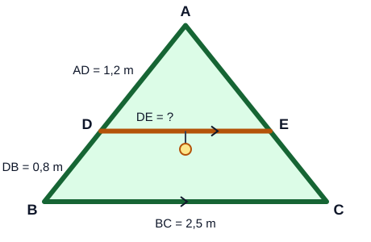

# Instrumen Post-test Mathematical Literacy: Kesebangunan

| | |
|---|---|
| Materi | Kesebangunan bangun datar dan segitiga |
| Sasaran | Siswa SMP kelas 9 |
| Bentuk soal | 4 soal uraian (1 soal untuk setiap indikator Mathematical Literacy) |
| Waktu | 60 menit |
| Skor maksimum | 24 |
| Pasangan | Setara (paralel) dengan [pre-test](pretest.md) |

---

## A. Lembar Soal (dibagikan kepada siswa)

Nama/Kode siswa: ................................ Kelas: ........ Tanggal: ................

**Petunjuk**

1. Kerjakan secara mandiri.
2. Tuliskan semua langkah penyelesaian, bukan hanya jawaban akhir. Langkah yang benar tetap mendapat nilai.
3. Boleh membuat sketsa atau gambar untuk membantu.

### Soal 1. Mencetak Logo Kelas

Bimo membuat desain logo kelas berukuran lebar 6 cm dan tinggi 9 cm. Ia ingin mencetak logo itu dalam ukuran lebih besar untuk dipasang di bingkai pajangan kelas. Bagian dalam bingkai berukuran lebar 25 cm dan tinggi 30 cm. Percetakan menawarkan empat ukuran berikut.

| Ukuran | Lebar | Tinggi |
|:---:|:---:|:---:|
| A | 12 cm | 18 cm |
| B | 10 cm | 13 cm |
| C | 18 cm | 27 cm |
| D | 24 cm | 36 cm |

Bimo ingin logonya tidak terlihat gepeng atau tertarik (bentuknya tetap sama dengan desain asli), sebesar mungkin, tetapi tetap muat di dalam bingkai. **Ukuran mana yang sebaiknya dipilih Bimo? Jelaskan alasan matematis Anda.**

### Soal 2. Spanduk di Gedung Sekolah

OSIS akan memasang spanduk vertikal dari atap gedung sekolah ke arah bawah. Panjang spanduk 12 m dan lebarnya 1,5 m. Spanduk dapat dipasang tanpa menyentuh tanah jika tinggi gedung tidak kurang dari panjang spanduk. Gedung itu terdiri atas 3 lantai. Pada pukul 14.00, Sari menancapkan tongkat tegak setinggi 2 m di halaman yang datar. Panjang bayangan tongkat 1,6 m, sedangkan panjang bayangan gedung pada saat yang sama 10,4 m. **Ubahlah situasi tersebut menjadi model matematika yang dapat digunakan untuk menentukan apakah spanduk dapat dipasang tanpa menyentuh tanah, kemudian selesaikan.**

### Soal 3. Lampu di Tenda Perkemahan

Penampang depan tenda pramuka berbentuk segitiga ABC seperti gambar. Di dalam tenda dipasang batang penyangga lampu DE yang sejajar dengan alas BC, dengan titik D pada AB dan titik E pada AC. Diketahui AD = 1,2 m, DB = 0,8 m, dan BC = 2,5 m. Panitia akan memasang batang yang sama pada 6 tenda. **Berapa meter panjang batang yang diperlukan seluruhnya? Tunjukkan langkah perhitungan Anda.**

### Soal 4. Memperbesar Denah Kelas

Tono menggambar denah ruang kelas berbentuk persegi panjang dengan lebar 5 cm dan panjang 8 cm. Ia ingin menggambar ulang denah itu di karton sehingga lebarnya menjadi 15 cm dan bentuknya tetap sebangun dengan denah semula. Tono menghitung:

> "Lebarnya bertambah 15 − 5 = 10 cm, jadi panjangnya juga ditambah 10 cm, yaitu 8 + 10 = 18 cm."

**Apakah Anda setuju dengan hasil Tono? Tentukan panjang denah yang seharusnya dan jelaskan alasan Anda.**

---

## B. Kisi-kisi Jawaban dan Pedoman Penskoran (untuk guru/peneliti)

| No. | Indikator | Soal | Kisi-kisi Jawaban per Tahapan Penyelesaian | Skor per Tahapan |
|:---:|---|---|---|---|
| 1 | **Mathematical Reasoning.** Siswa mampu mengidentifikasi hubungan matematis, membandingkan alternatif, memberikan alasan, dan menentukan keputusan yang dapat dipertanggungjawabkan. | **Mencetak Logo Kelas.** Logo 6 cm × 9 cm akan dicetak lebih besar. Bagian dalam bingkai 25 cm × 30 cm. Pilihan ukuran: A 12 × 18, B 10 × 13, C 18 × 27, D 24 × 36 (cm). Logo harus tidak gepeng, sebesar mungkin, dan muat. **Ukuran mana yang sebaiknya dipilih? Jelaskan alasan matematis Anda.** | **Tahap 1:** Agar tidak gepeng, logo cetakan harus sebangun dengan desain asli, artinya lebar baru : lebar asli harus sama dengan tinggi baru : tinggi asli. Ukurannya juga tidak boleh melebihi 25 cm × 30 cm. Jadi saya harus memeriksa perbandingan setiap ukuran, bukan hanya memilih yang paling besar. **Tahap 2:** A: 12 : 6 = 2 dan 18 : 9 = 2 (sama). B: 10 : 6 ≈ 1,67 dan 13 : 9 ≈ 1,44 (tidak sama). C: 18 : 6 = 3 dan 27 : 9 = 3 (sama). D: 24 : 6 = 4 dan 36 : 9 = 4 (sama). **Tahap 3:** Yang sebangun dengan desain asli adalah A, C, dan D; B tidak sebangun. D tingginya 36 cm > 30 cm sehingga tidak muat, sedangkan A dan C muat. Di antara yang sebangun dan muat, C (18 × 27) lebih besar daripada A (12 × 18). **Tahap 4:** Bimo sebaiknya memilih ukuran C (18 cm × 27 cm). **Tahap 5:** Alasannya, C sebangun dengan desain asli (semua sisi dikali 3) sehingga tidak gepeng, muat di bingkai, dan paling besar di antara ukuran yang memenuhi. B tidak sebangun karena setiap sisinya hanya ditambah 4 cm, bukan dikali; D sebangun tetapi tidak muat; A muat tetapi lebih kecil. | Tahap 1 = 1; Tahap 2 = 2; Tahap 3 = 1; Tahap 4 = 1; Tahap 5 = 1. **Skor maksimum = 6** |
| 2 | **Formulating Situations Mathematically.** Siswa mampu mengidentifikasi informasi relevan, menentukan besaran, dan menerjemahkan situasi nyata menjadi model matematika. | **Spanduk di Gedung Sekolah.** Spanduk 12 m dipasang vertikal dari atap. Tongkat tegak 2 m, bayangannya 1,6 m. Bayangan gedung pada saat yang sama 10,4 m. Ada juga informasi lebar spanduk (1,5 m), jumlah lantai (3), dan waktu (pukul 14.00). **Ubahlah situasi menjadi model matematika untuk menentukan apakah spanduk dapat dipasang tanpa menyentuh tanah, kemudian selesaikan.** | **Tahap 1:** Diketahui (yang relevan): tinggi tongkat 2 m, bayangan tongkat 1,6 m, bayangan gedung 10,4 m, panjang spanduk 12 m. Lebar spanduk, jumlah lantai, dan waktu tidak diperlukan. Ditanya: apakah tinggi gedung paling sedikit 12 m? **Tahap 2:** Tongkat dan gedung sama-sama tegak lurus tanah, dan pada saat yang sama sinar matahari datang dengan sudut yang sama. Jadi segitiga tongkat–bayangan sebangun dengan segitiga gedung–bayangan. Misalkan tinggi gedung = g meter. **Tahap 3:** Pasangan sisi seletak: tinggi ↔ tinggi, bayangan ↔ bayangan. Model: g : 2 = 10,4 : 1,6 atau g/2 = 10,4/1,6. **Tahap 4:** 1,6 × g = 2 × 10,4 = 20,8, sehingga g = 20,8 : 1,6 = 13 m. **Tahap 5:** Spanduk dapat dipasang jika g ≥ 12. Ternyata 13 m ≥ 12 m. **Tahap 6:** Jadi spanduk dapat dipasang tanpa menyentuh tanah; ujung bawahnya masih 13 − 12 = 1 m di atas tanah. | Tahap 1 = 1; Tahap 2 = 1; Tahap 3 = 1; Tahap 4 = 1; Tahap 5 = 1; Tahap 6 = 1. **Skor maksimum = 6** |
| 3 | **Employing Mathematical Concepts, Facts, and Procedures.** Siswa mampu memilih serta menggunakan konsep, operasi, prosedur, dan strategi matematika untuk memperoleh solusi. | **Lampu di Tenda Perkemahan.** Penampang tenda segitiga ABC dengan batang DE ∥ BC (D pada AB, E pada AC). AD = 1,2 m, DB = 0,8 m, BC = 2,5 m. Batang dipasang pada 6 tenda. **Berapa meter batang yang diperlukan seluruhnya? Tunjukkan langkah perhitungan Anda.** | **Tahap 1:** AB = AD + DB = 1,2 m + 0,8 m = 2 m. **Tahap 2:** Karena DE ∥ BC, ΔADE sebangun dengan ΔABC (∠A dimiliki bersama dan ∠ADE = ∠ABC karena sehadap). Pasangan sisi seletak AD ↔ AB dan DE ↔ BC, sehingga DE/BC = AD/AB. **Tahap 3:** DE/2,5 = 1,2/2, maka DE = (1,2 × 2,5) : 2 = 3 : 2 = 1,5 m. Batang untuk 6 tenda = 6 × 1,5 m = 9 m. **Tahap 4:** Jadi batang yang diperlukan seluruhnya adalah 9 m. | Tahap 1 = 1; Tahap 2 = 2; Tahap 3 = 2; Tahap 4 = 1. **Skor maksimum = 6** |
| 4 | **Interpreting, Applying, and Evaluating Mathematical Outcomes.** Siswa mampu menafsirkan hasil matematika dalam konteks, menilai kewajaran hasil, dan mengambil keputusan berdasarkan hasil perhitungan. | **Memperbesar Denah Kelas.** Denah 5 cm × 8 cm digambar ulang dengan lebar 15 cm dan harus sebangun. Tono menghitung: lebar bertambah 10 cm, jadi panjang = 8 + 10 = 18 cm. **Apakah Anda setuju? Tentukan panjang denah yang seharusnya dan jelaskan alasan Anda.** | **Tahap 1:** Tono menambahkan selisih yang sama pada setiap sisi. Padahal dua persegi panjang sebangun jika perbandingan sisi-sisi seletaknya sama (dikali dengan faktor yang sama), bukan ditambah dengan bilangan yang sama. Jadi hasil Tono perlu diperiksa. **Tahap 2:** Faktor skala = lebar baru : lebar lama = 15 : 5 = 3. **Tahap 3:** Panjang yang seharusnya = 8 × 3 = 24 cm. **Tahap 4:** Memeriksa hasil Tono: 18 : 8 = 2,25, sedangkan 15 : 5 = 3. Perbandingannya tidak sama, jadi denah Tono tidak sebangun (terlihat lebih pendek). Pemeriksaan jawaban: 24 : 8 = 3 = 15 : 5. **Tahap 5:** Saya tidak setuju dengan Tono. Memperbesar bangun agar sebangun berarti semua sisi dikali dengan faktor yang sama, bukan ditambah panjang yang sama. **Tahap 6:** Jadi panjang denah pada karton seharusnya 24 cm (ukuran 15 cm × 24 cm). | Tahap 1 = 1; Tahap 2 = 1; Tahap 3 = 1; Tahap 4 = 1; Tahap 5 = 1; Tahap 6 = 1. **Skor maksimum = 6** |

## C. Rekap Skor

| Indikator | Skor Maksimum |
|---|:---:|
| Mathematical Reasoning | 6 |
| Formulating Situations Mathematically | 6 |
| Employing Mathematical Concepts, Facts, and Procedures | 6 |
| Interpreting, Applying, and Evaluating Mathematical Outcomes | 6 |
| **Total** | **24** |

## D. Pedoman Umum Penskoran

- **Skor penuh** diberikan apabila siswa menunjukkan tahapan penyelesaian yang benar, menggunakan prosedur matematika yang tepat, dan memberikan kesimpulan sesuai konteks.
- **Skor parsial** tetap diberikan apabila siswa telah menunjukkan tahapan berpikir yang benar tetapi melakukan kesalahan hitung pada tahap berikutnya. Contoh pada soal 3: jika siswa benar menghitung AB = 2 m dan benar menulis DE/BC = AD/AB, tetapi keliru menghitung DE, siswa tetap memperoleh skor Tahap 1 dan Tahap 2.
- Kesalahan konsep yang sering muncul tidak diberi skor pada tahap yang bersangkutan. Contohnya: memakai DB sebagai pengganti AB pada soal 3, atau menambah panjang yang sama pada soal 1 dan soal 4.
- Prinsip ini penting karena instrumen ditujukan untuk mengukur **proses** mathematical literacy, bukan hanya ketepatan jawaban akhir.
