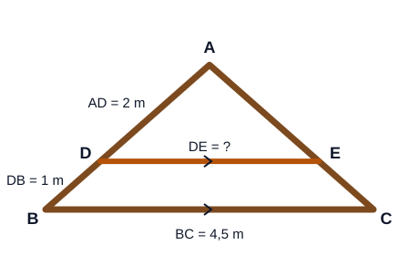

# Instrumen Pre-test Mathematical Literacy: Kesebangunan

| | |
|---|---|
| Materi | Kesebangunan bangun datar dan segitiga |
| Sasaran | Siswa SMP kelas 9 |
| Bentuk soal | 4 soal uraian (1 soal untuk setiap indikator Mathematical Literacy) |
| Waktu | 60 menit |
| Skor maksimum | 24 |
| Pasangan | Setara (paralel) dengan [post-test](posttest.md) |

---

## A. Lembar Soal (dibagikan kepada siswa)

Nama/Kode siswa: ................................ Kelas: ........ Tanggal: ................

**Petunjuk**

1. Kerjakan secara mandiri.
2. Tuliskan semua langkah penyelesaian, bukan hanya jawaban akhir. Langkah yang benar tetap mendapat nilai.
3. Boleh membuat sketsa atau gambar untuk membantu.

### Soal 1. Memperbesar Foto untuk Mading

Dina memiliki foto berukuran lebar 10 cm dan tinggi 15 cm. Ia ingin mencetak ulang foto itu dalam ukuran lebih besar untuk ditempel di papan mading. Tempat yang tersedia di papan mading selebar 60 cm dan setinggi 50 cm. Tukang cetak menawarkan empat ukuran berikut.

| Ukuran | Lebar | Tinggi |
|:---:|:---:|:---:|
| A | 20 cm | 30 cm |
| B | 15 cm | 20 cm |
| C | 30 cm | 45 cm |
| D | 40 cm | 60 cm |

Dina ingin fotonya tidak terlihat gepeng atau tertarik (bentuknya tetap sama dengan foto asli), sebesar mungkin, tetapi tetap muat di papan mading. **Ukuran mana yang sebaiknya dipilih Dina? Jelaskan alasan matematis Anda.**

### Soal 2. Pohon di Bawah Kabel Listrik

Di depan sekolah ada pohon mangga berumur 12 tahun yang tumbuh di bawah kabel listrik. Kabel listrik itu berada 7 m di atas tanah. Petugas akan memangkas pohon jika pohon lebih tinggi daripada kabel. Pada pukul 10.00, Andi menancapkan tongkat tegak setinggi 1,5 m di tanah datar dekat pohon. Panjang bayangan tongkat 1,2 m, sedangkan panjang bayangan pohon pada saat yang sama 6,4 m. Diameter batang pohon itu 40 cm. **Ubahlah situasi tersebut menjadi model matematika yang dapat digunakan untuk menentukan apakah pohon perlu dipangkas, kemudian selesaikan.**

### Soal 3. Rangka Atap

Pak Budi membuat rangka atap berbentuk segitiga ABC seperti gambar. Di dalam rangka dipasang balok penguat DE yang sejajar dengan balok dasar BC, dengan titik D pada AB dan titik E pada AC. Diketahui AD = 2 m, DB = 1 m, dan BC = 4,5 m. Pak Budi akan membuat 4 rangka atap yang sama. **Berapa meter panjang kayu yang diperlukan untuk seluruh balok penguat DE? Tunjukkan langkah perhitungan Anda.**

### Soal 4. Memperbesar Denah Kebun

Rina menggambar denah kebun sekolah berbentuk persegi panjang dengan lebar 4 cm dan panjang 6 cm. Ia ingin menggambar ulang denah itu pada poster sehingga lebarnya menjadi 10 cm dan bentuknya tetap sebangun dengan denah semula. Rina menghitung:

> "Lebarnya bertambah 10 − 4 = 6 cm, jadi panjangnya juga ditambah 6 cm, yaitu 6 + 6 = 12 cm."

**Apakah Anda setuju dengan hasil Rina? Tentukan panjang denah yang seharusnya dan jelaskan alasan Anda.**

---

## B. Kisi-kisi Jawaban dan Pedoman Penskoran (untuk guru/peneliti)

| No. | Indikator | Soal | Kisi-kisi Jawaban per Tahapan Penyelesaian | Skor per Tahapan |
|:---:|---|---|---|---|
| 1 | **Mathematical Reasoning.** Siswa mampu mengidentifikasi hubungan matematis, membandingkan alternatif, memberikan alasan, dan menentukan keputusan yang dapat dipertanggungjawabkan. | **Memperbesar Foto untuk Mading.** Foto 10 cm × 15 cm akan dicetak lebih besar. Tempat di mading 60 cm × 50 cm. Pilihan ukuran: A 20 × 30, B 15 × 20, C 30 × 45, D 40 × 60 (cm). Foto harus tidak gepeng, sebesar mungkin, dan muat. **Ukuran mana yang sebaiknya dipilih? Jelaskan alasan matematis Anda.** | **Tahap 1:** Agar tidak gepeng, foto cetakan harus sebangun dengan foto asli, artinya lebar baru : lebar asli harus sama dengan tinggi baru : tinggi asli. Ukurannya juga tidak boleh melebihi 60 cm × 50 cm. Jadi saya harus memeriksa perbandingan setiap ukuran, bukan hanya memilih yang paling besar. **Tahap 2:** A: 20 : 10 = 2 dan 30 : 15 = 2 (sama). B: 15 : 10 = 1,5 dan 20 : 15 ≈ 1,33 (tidak sama). C: 30 : 10 = 3 dan 45 : 15 = 3 (sama). D: 40 : 10 = 4 dan 60 : 15 = 4 (sama). **Tahap 3:** Yang sebangun dengan foto asli adalah A, C, dan D; B tidak sebangun. D tingginya 60 cm > 50 cm sehingga tidak muat, sedangkan A dan C muat. Di antara yang sebangun dan muat, C (30 × 45) lebih besar daripada A (20 × 30). **Tahap 4:** Dina sebaiknya memilih ukuran C (30 cm × 45 cm). **Tahap 5:** Alasannya, C sebangun dengan foto asli (semua sisi dikali 3) sehingga tidak gepeng, muat di mading, dan paling besar di antara ukuran yang memenuhi. B tidak sebangun karena setiap sisinya hanya ditambah 5 cm, bukan dikali; D sebangun tetapi tidak muat; A muat tetapi lebih kecil. | Tahap 1 = 1; Tahap 2 = 2; Tahap 3 = 1; Tahap 4 = 1; Tahap 5 = 1. **Skor maksimum = 6** |
| 2 | **Formulating Situations Mathematically.** Siswa mampu mengidentifikasi informasi relevan, menentukan besaran, dan menerjemahkan situasi nyata menjadi model matematika. | **Pohon di Bawah Kabel Listrik.** Kabel listrik 7 m di atas tanah. Tongkat tegak 1,5 m, bayangannya 1,2 m. Bayangan pohon pada saat yang sama 6,4 m. Ada juga informasi umur pohon (12 tahun), waktu (pukul 10.00), dan diameter batang (40 cm). **Ubahlah situasi menjadi model matematika untuk menentukan apakah pohon perlu dipangkas, kemudian selesaikan.** | **Tahap 1:** Diketahui (yang relevan): tinggi tongkat 1,5 m, bayangan tongkat 1,2 m, bayangan pohon 6,4 m, tinggi kabel 7 m. Umur pohon, waktu, dan diameter batang tidak diperlukan. Ditanya: apakah tinggi pohon lebih dari 7 m? **Tahap 2:** Tongkat dan pohon sama-sama tegak lurus tanah, dan pada saat yang sama sinar matahari datang dengan sudut yang sama. Jadi segitiga tongkat–bayangan sebangun dengan segitiga pohon–bayangan. Misalkan tinggi pohon = t meter. **Tahap 3:** Pasangan sisi seletak: tinggi ↔ tinggi, bayangan ↔ bayangan. Model: t : 1,5 = 6,4 : 1,2 atau t/1,5 = 6,4/1,2. **Tahap 4:** 1,2 × t = 1,5 × 6,4 = 9,6, sehingga t = 9,6 : 1,2 = 8 m. **Tahap 5:** Pohon perlu dipangkas jika t > 7. Ternyata 8 m > 7 m. **Tahap 6:** Jadi pohon perlu dipangkas, karena tingginya 8 − 7 = 1 m di atas kabel listrik. | Tahap 1 = 1; Tahap 2 = 1; Tahap 3 = 1; Tahap 4 = 1; Tahap 5 = 1; Tahap 6 = 1. **Skor maksimum = 6** |
| 3 | **Employing Mathematical Concepts, Facts, and Procedures.** Siswa mampu memilih serta menggunakan konsep, operasi, prosedur, dan strategi matematika untuk memperoleh solusi. | **Rangka Atap.** Rangka segitiga ABC dengan balok penguat DE ∥ BC (D pada AB, E pada AC). AD = 2 m, DB = 1 m, BC = 4,5 m. Akan dibuat 4 rangka yang sama. **Berapa meter kayu untuk seluruh balok DE? Tunjukkan langkah perhitungan Anda.** | **Tahap 1:** AB = AD + DB = 2 m + 1 m = 3 m. **Tahap 2:** Karena DE ∥ BC, ΔADE sebangun dengan ΔABC (∠A dimiliki bersama dan ∠ADE = ∠ABC karena sehadap). Pasangan sisi seletak AD ↔ AB dan DE ↔ BC, sehingga DE/BC = AD/AB. **Tahap 3:** DE/4,5 = 2/3, maka DE = (2 × 4,5) : 3 = 9 : 3 = 3 m. Kayu untuk 4 rangka = 4 × 3 m = 12 m. **Tahap 4:** Jadi kayu yang diperlukan untuk seluruh balok penguat adalah 12 m. | Tahap 1 = 1; Tahap 2 = 2; Tahap 3 = 2; Tahap 4 = 1. **Skor maksimum = 6** |
| 4 | **Interpreting, Applying, and Evaluating Mathematical Outcomes.** Siswa mampu menafsirkan hasil matematika dalam konteks, menilai kewajaran hasil, dan mengambil keputusan berdasarkan hasil perhitungan. | **Memperbesar Denah Kebun.** Denah 4 cm × 6 cm digambar ulang dengan lebar 10 cm dan harus sebangun. Rina menghitung: lebar bertambah 6 cm, jadi panjang = 6 + 6 = 12 cm. **Apakah Anda setuju? Tentukan panjang denah yang seharusnya dan jelaskan alasan Anda.** | **Tahap 1:** Rina menambahkan selisih yang sama pada setiap sisi. Padahal dua persegi panjang sebangun jika perbandingan sisi-sisi seletaknya sama (dikali dengan faktor yang sama), bukan ditambah dengan bilangan yang sama. Jadi hasil Rina perlu diperiksa. **Tahap 2:** Faktor skala = lebar baru : lebar lama = 10 : 4 = 2,5. **Tahap 3:** Panjang yang seharusnya = 6 × 2,5 = 15 cm. **Tahap 4:** Memeriksa hasil Rina: 12 : 6 = 2, sedangkan 10 : 4 = 2,5. Perbandingannya tidak sama, jadi denah Rina tidak sebangun (terlihat lebih pendek). Pemeriksaan jawaban: 15 : 6 = 2,5 = 10 : 4. **Tahap 5:** Saya tidak setuju dengan Rina. Memperbesar bangun agar sebangun berarti semua sisi dikali dengan faktor yang sama, bukan ditambah panjang yang sama. **Tahap 6:** Jadi panjang denah pada poster seharusnya 15 cm (ukuran 10 cm × 15 cm). | Tahap 1 = 1; Tahap 2 = 1; Tahap 3 = 1; Tahap 4 = 1; Tahap 5 = 1; Tahap 6 = 1. **Skor maksimum = 6** |

## C. Rekap Skor

| Indikator | Skor Maksimum |
|---|:---:|
| Mathematical Reasoning | 6 |
| Formulating Situations Mathematically | 6 |
| Employing Mathematical Concepts, Facts, and Procedures | 6 |
| Interpreting, Applying, and Evaluating Mathematical Outcomes | 6 |
| **Total** | **24** |

## D. Pedoman Umum Penskoran

- **Skor penuh** diberikan apabila siswa menunjukkan tahapan penyelesaian yang benar, menggunakan prosedur matematika yang tepat, dan memberikan kesimpulan sesuai konteks.
- **Skor parsial** tetap diberikan apabila siswa telah menunjukkan tahapan berpikir yang benar tetapi melakukan kesalahan hitung pada tahap berikutnya. Contoh pada soal 3: jika siswa benar menghitung AB = 3 m dan benar menulis DE/BC = AD/AB, tetapi keliru menghitung DE, siswa tetap memperoleh skor Tahap 1 dan Tahap 2.
- Kesalahan konsep yang sering muncul tidak diberi skor pada tahap yang bersangkutan. Contohnya: memakai DB sebagai pengganti AB pada soal 3, atau menambah panjang yang sama pada soal 1 dan soal 4.
- Prinsip ini penting karena instrumen ditujukan untuk mengukur **proses** mathematical literacy, bukan hanya ketepatan jawaban akhir.
